# ME193 Gait Identifier

A wearable that tells whether you are **standing still, walking, running or biking** (air-biking, lying on your back). An Arduino UNO Q with an MPU-6050 motion sensor (3-axis accelerometer + 3-axis gyroscope) is strapped to the ankle, and every half second a decision tree classifies the last 2 seconds of motion. No neural networks.

Two models are compared to see what the extra sensor information is worth:

- **Model A** sees **one number**: the peak acceleration along the shin (`ax_max`).
- **Model B** sees **all six sensor outputs**: 34 numbers per window.

On a person it had never seen, **Model B was right 97% of the time and Model A only 65% to 83%**, because one number cannot tell walking from running or running from biking.

<p align="center">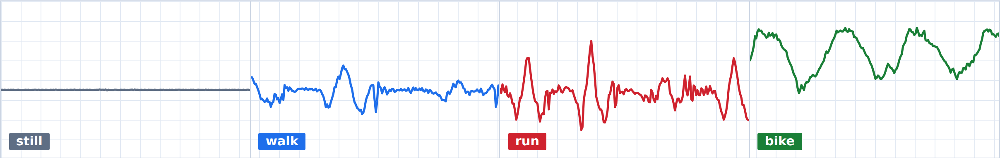</p>
<p align="center"><em>Four seconds of real sensor data for each activity: standing is flat, walking and running are bumpy, biking swings smoothly.</em></p>

**Status:** complete. The training, the evaluation and all three apps pass 12 groups of automated tests (`python run_all_tests.py`), and the apps have run on the real board.

## Contents

- [Overview](#overview)
- [How it works](#how-it-works)
- [Results](#results)
- [Hardware](#hardware)
- [The apps that run on the UNO Q](#the-apps-that-run-on-the-uno-q)
- [Repository layout](#repository-layout)
- [Reproduce the results](#reproduce-the-results)
- [Data](#data)
- [Limitations and next steps](#limitations-and-next-steps)

## Overview

<p align="center">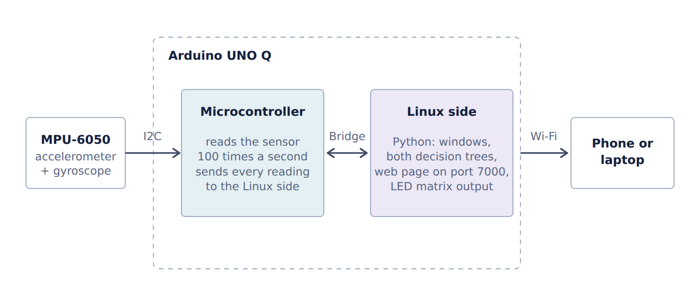</p>

The microcontroller on the UNO Q reads the sensor 100 times a second and passes every reading across the Bridge to the Linux side. The Linux side cuts the readings into windows, runs both decision trees, and serves a web page and drives the LED matrix.

The project runs in three places: the board records labelled data, a laptop trains the trees, and the board then runs them live.

<p align="center">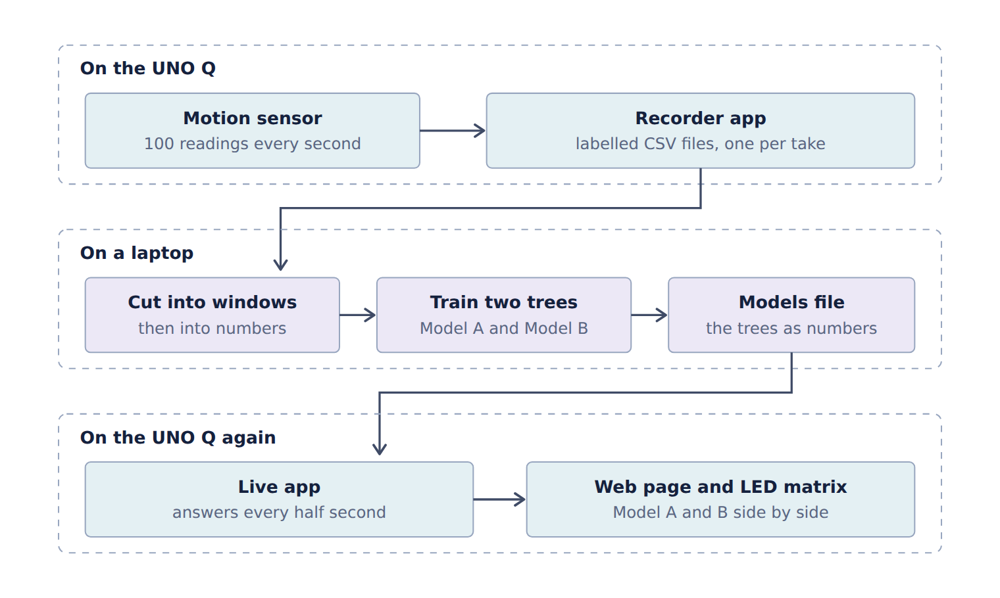</p>

## How it works

<p align="center">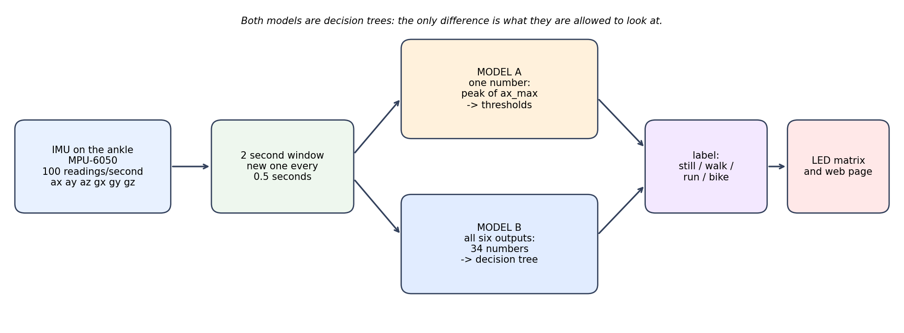</p>

1. The MPU-6050 measures acceleration (in g) and rotation (in degrees per second) along three axes, 100 times a second. The microcontroller reads it and passes every reading to the Linux side.
2. The stream is cut into **2-second windows** (200 samples), a new one every 0.5 seconds, so neighbouring windows overlap by 75%.
3. Each window is summarised into numbers, called *features*.
4. A **decision tree**, a flowchart of yes/no questions learned from labelled examples, turns the numbers into an answer.
5. Model A is allowed to see one number. Model B is allowed to see 34.
6. Both trees run live on the board. Both answers are shown on a web page and on the LED matrix.

<p align="center">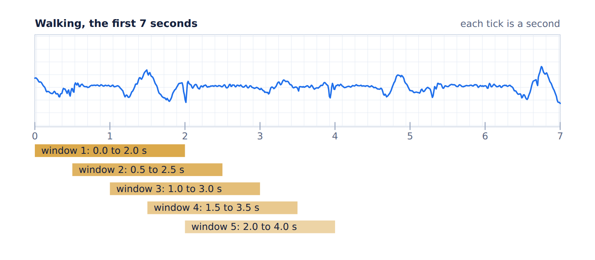</p>

In pseudocode:

```
every half second, on the last 2 seconds of sensor data (200 samples of 6 numbers):
    a_number  = the highest ax in the window                      # Model A's only input
    b_numbers = 34 summary numbers from all six outputs           # Model B's input
    answer_A  = walk Model A's small decision tree using a_number
    answer_B  = walk Model B's decision tree using b_numbers
    show both answers on the web page and on the LED matrix

training, on the laptop:
    label every window with the activity of the recording it came from
    learn both trees from the labelled windows
    test them on a person the trees never saw
```

| | Model A | Model B |
|---|---|---|
| **Sees** | `ax_max`: the highest value of the shin-axis acceleration in the window | 34 numbers: the average, spread, lowest and highest of each of the six outputs, the size of the total acceleration and rotation, and two rhythm measures |
| **Tree** | 3 thresholds: at most -0.84 g is still, at most -0.24 g walk, at most +0.27 g run, above that bike | 4 questions deep. It ended up using mostly the lowest and highest `ay`, the average acceleration and a few rotation numbers |

A decision tree picks each question by trying every possible cut and keeping the one that leaves the purest groups. In this small example (8 made-up windows) the score of a cut is the weighted *mixing score* of the two groups it creates (1 minus the sum of the squared class shares): cut 1 scores 0.30 and cut 2 scores 0.375, so the tree takes cut 1. Lower is better.

<p align="center">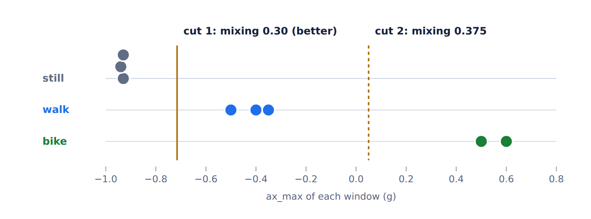</p>

The interesting parts of the code:

| Step | Where |
|---|---|
| Cut a recording into windows | [`gait_features.py`](gait-identifier/gait_features.py): `windows` |
| Model A's one number | [`gait_features.py`](gait-identifier/gait_features.py): `peak` |
| Model B's 34 numbers | [`gait_features.py`](gait-identifier/gait_features.py): `features_b`, `rhythm` |
| Learn the two trees | [`train_gait.py`](gait-identifier/train_gait.py): `final_models` |
| Choose Model A's number without peeking at the test person | [`train_gait.py`](gait-identifier/train_gait.py): `choose_peak` |
| Test on a person the model has never seen | [`train_gait.py`](gait-identifier/train_gait.py): `run_protocols` |
| Run a saved tree on the board, with no machine-learning library | [`gait_predict.py`](gait-identifier/gait_predict.py): `predict_tree` |
| Live windows, both models, smoothing, scoring | [`gait-live/python/main.py`](gait-identifier/apps/gait-live/python/main.py): `Live` |
| Read the sensor 100 times a second | [`gait-live/sketch/sketch.ino`](gait-identifier/apps/gait-live/sketch/sketch.ino): `loop` |

## Results

Accuracy is the share of 2-second windows labelled correctly. Guessing would score 25%.

| Test | Model A, number chosen fairly | Model A, deployed number (optimistic) | **Model B, all six outputs** |
|---|---|---|---|
| **New person** (train on one, test on the other) | 65% | 83% | **97%** |
| **New recording** (same two people) | 85% | 85% | **98%** |

<p align="center">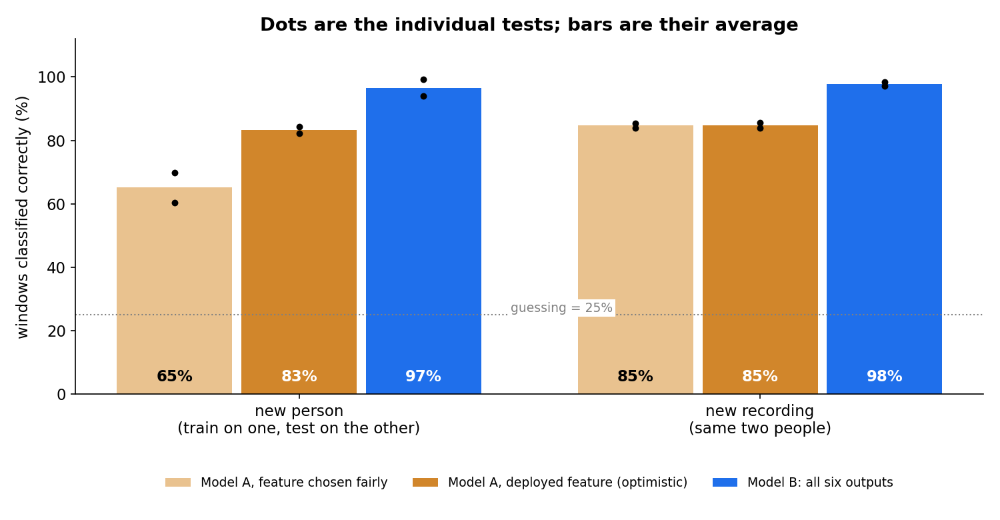</p>

**Why two numbers for Model A.** Model A has to choose which of nine one-number features to use. With only two people, that choice can be made fairly (using only the training person's recordings) from just one person, and the choice did not carry over. The version on the board uses `ax_max`, chosen with both people's data, so its 83% is optimistic. The truth for a new person lies between 65% and 83%. A third person would settle it. An earlier quick evaluation gave Model A 82% to 86% because its feature had been picked by looking at the test person; the evaluation was rebuilt so the person being tested cannot influence any choice. With the test labels shuffled the score falls to 26%, which is guessing.

**Why Model B wins.**

- One number cannot separate neighbours: walking overlaps running and running overlaps biking, so Model A's mistakes are always those neighbours.
- Model B also sees the size of the movement, the rotation and the Y axis (which reveals posture when lying on the back).
- Model B's one weakness: trained on one person only, it called 23% of the other person's running "walking". That person runs less hard (1.34 g average acceleration while running, against 1.53 g). More people in the training data is the fix.
- A bigger model did not help: a random forest scored 96.5% on a new person against 96.6% for the single tree, so the limit is the data.

The windows overlap by 75%, so read differences of a few percent as noise. All tables and the confusion matrices are in [`gait-identifier/results/`](gait-identifier/results/) (start with [`summary.md`](gait-identifier/results/summary.md)).

<p align="center">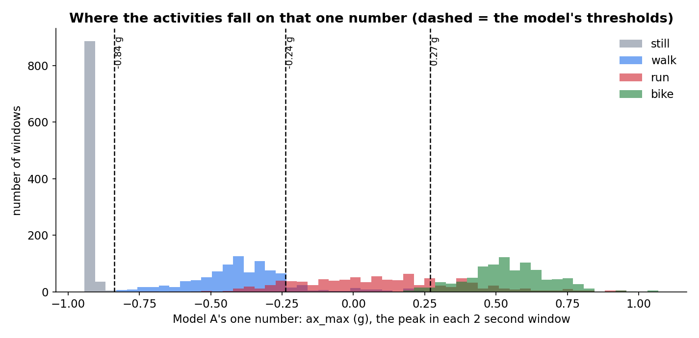</p>

<p align="center">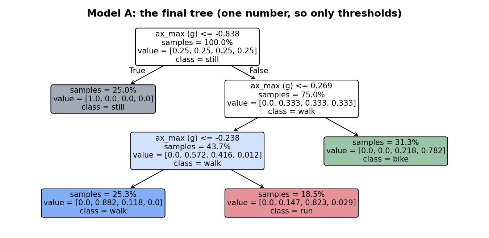</p>

## Hardware

**Parts**

- Arduino UNO Q
- MPU-6050 motion sensor on four jumper wires
- USB power bank and a USB-C cable
- 3D-printed PLA case
- Velcro one-wrap ties

**Orientation.** The model depends on which axis points where, so the unit has to go on the same way every time. On the ankle the X axis runs down the shin, so standing still gravity shows up on X.

<p align="center">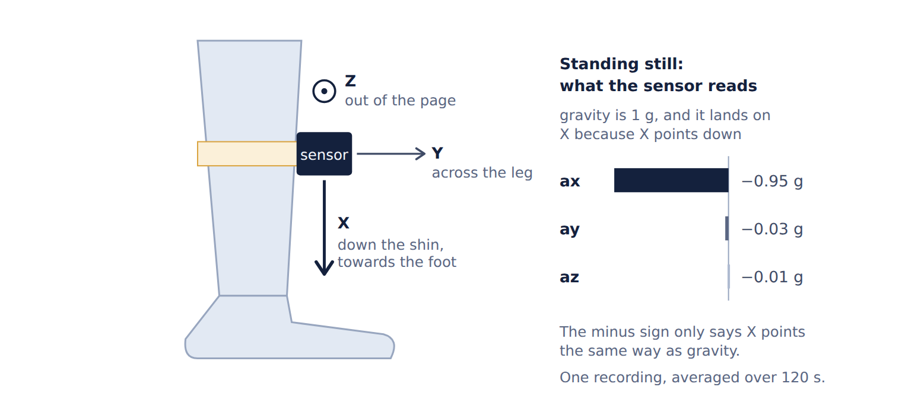</p>

**Wiring.** The board's pins are 3.3 V logic, so power the sensor from 3V3, not 5V.

<p align="center">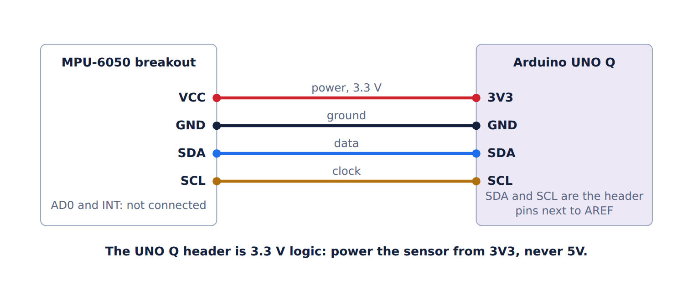</p>

| MPU-6050 pin | UNO Q |
|---|---|
| VCC | 3V3 |
| GND | GND |
| SDA | SDA (the header pin next to AREF) |
| SCL | SCL (the header pin next to AREF) |
| AD0, INT | leave unconnected |

**Case.** The UNO Q sits in a 3D-printed PLA case with a tray for the board, a mount for the sensor, a mount for the battery, and slots for Velcro one-wrap ties that hold it on the ankle.

<p align="center">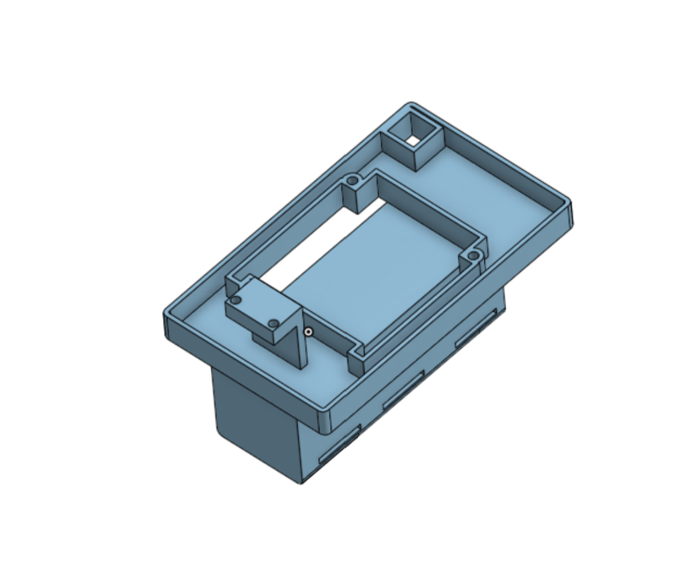 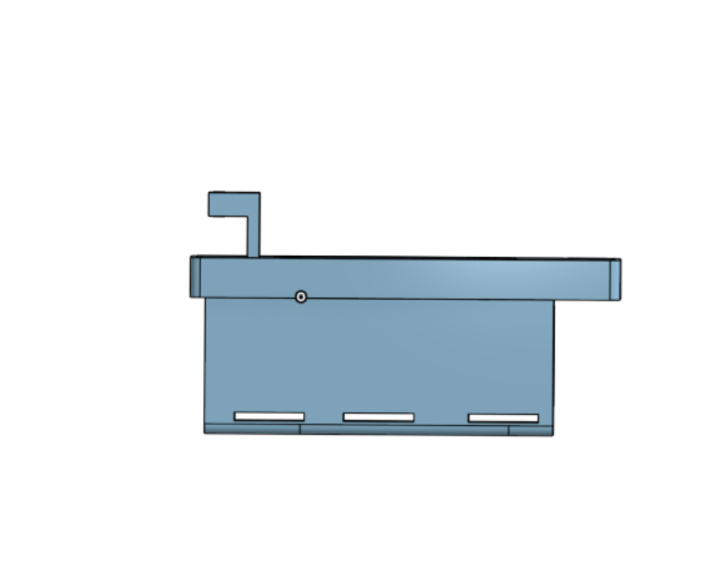</p>

## The apps that run on the UNO Q

Copy a folder from [`gait-identifier/apps/`](gait-identifier/apps/) into Arduino App Lab as an app and press Run. Each folder has its own README.

| App | What it does |
|---|---|
| [`gait-imu-check`](gait-identifier/apps/gait-imu-check/) | Checks the sensor is wired and working: a guided still, shake and rotate self-test with PASS or FAIL |
| [`gait-recorder`](gait-identifier/apps/gait-recorder/) | Records labelled CSV files (still, walk, run, bike), controlled from a web page on a phone or laptop. The LED matrix shows the countdown and progress |
| [`gait-live`](gait-identifier/apps/gait-live/) | **The live demo.** Both models side by side on a web page and on the LED matrix, with a test mode that scores each model on whoever is wearing it |

To run the live demo, open `http://<board-ip>:7000` on a phone or laptop on the same network. In test mode, type the person's name and tap what they are really doing: each model gets a live score, and every scored window is saved to `live_log.csv`.

The live page shows both models side by side, with the questions each decision tree asked to reach its answer. This is an illustration built from real values (a running window where the two models disagree), not a screenshot:

<p align="center">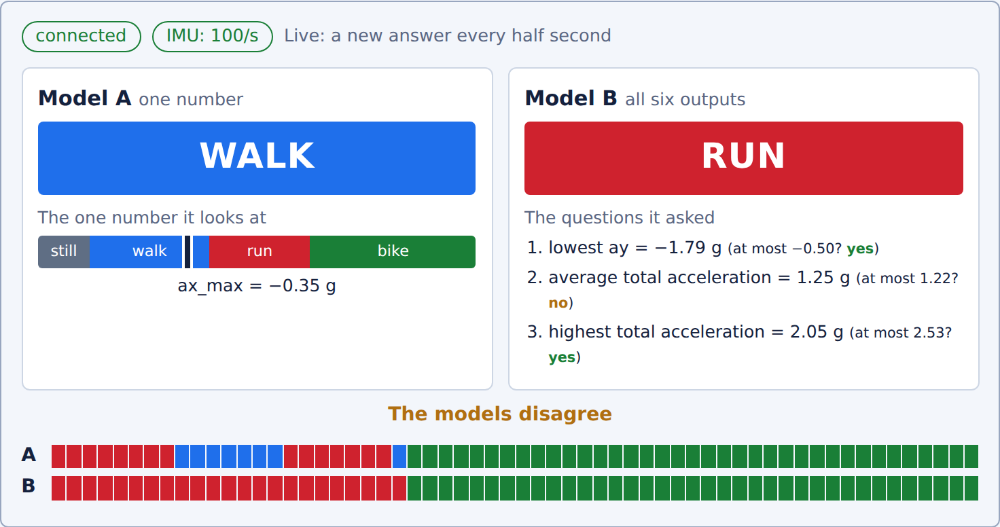</p>

The same two answers appear on the board's LED matrix: Model A's letter on the left and Model B's on the right (S still, W walk, R run, B bike), with a dotted divider when they disagree.

<p align="center">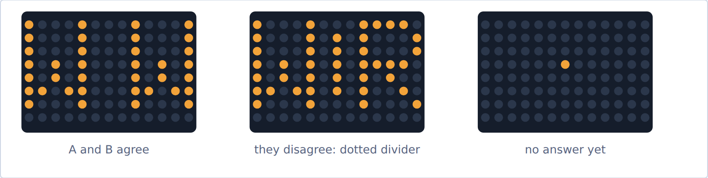</p>

## Repository layout

```
.
├── README.md                       this file
├── docs/images/                    the illustrations used in this README
├── gait-identifier/                the project
│   ├── data/                       the 16 labelled recordings and manifest.csv
│   ├── gait_features.py            windows and features (used by training and by the live app)
│   ├── train_gait.py               trains and evaluates both models, writes results/ and models/
│   ├── gait_predict.py             runs the saved trees on the board, with no scikit-learn
│   ├── models/gait_models.json     the two trained trees
│   ├── results/                    figures, summary.md, results.json
│   ├── apps/                       the three UNO Q apps: gait-imu-check, gait-recorder, gait-live
│   ├── tests/, run_all_tests.py    tests for the whole project
│   └── sync_live_app.py, requirements.txt
├── gait-imu-check/                 copy of gait-identifier/apps/gait-imu-check
├── gait-recorder/                  copy of gait-identifier/apps/gait-recorder
└── gait-live/                      copy of gait-identifier/apps/gait-live
```

The three top-level app folders are identical copies of the ones in `gait-identifier/apps/`.

## Reproduce the results

```
cd gait-identifier
pip install -r requirements.txt
python train_gait.py          # evaluates both models, writes results/ and models/gait_models.json
python run_all_tests.py       # every test in the project
python sync_live_app.py       # after retraining: copies the new models into the live app
```

`train_gait.py` reproduces every number in this README from the data. `run_all_tests.py` skips, instead of failing, the groups whose tools are not installed: the sketch tests need `g++` and the page tests need `node` plus `npm install jsdom`.

## Data

16 labelled recordings in [`gait-identifier/data/`](gait-identifier/data/): 2 people x 4 activities x 2 recordings x about 120 seconds, recorded on the same unit, 32 minutes in all. Each CSV has one row per sample at 100 samples a second: a counter `n`, then `ax, ay, az` (acceleration in g) and `gx, gy, gz` (rotation in degrees per second). The counter makes a lost sample visible as a jump. [`manifest.csv`](gait-identifier/data/manifest.csv) lists who, what, when, how many samples and the percentage lost (0% for every file). Training trims the first and last second of every recording and cuts the rest into 3,712 two-second windows.

## Limitations and next steps

- **Two people, 32 minutes of data.** Windows overlap, so there are about a quarter as many independent windows as the counts suggest. A third person would turn "between 65% and 83%" into a real measurement.
- **Biking here is air-biking on the back.** Model B partly relies on posture, so a real bicycle, sitting up, would probably fool it.
- **The mounting must be the same every time,** because the models depend on which axis points where.
- **People exercise at different intensities,** as the difference between the two people's running shows.
- **Next:** record more people, try a real bike, and test with other people wearing the unit.

## Acknowledgements

Course project for ME 193.
