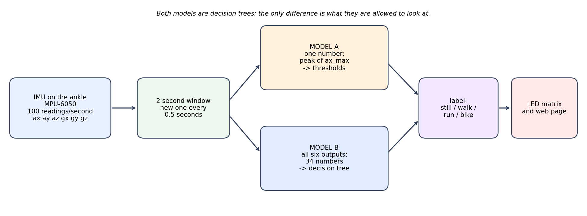

# ME193 Gait Identifier

A wearable that tells whether you are **standing still, walking, running or biking**. It is an Arduino UNO Q with an MPU-6050 motion sensor (3-axis accelerometer + 3-axis gyroscope) strapped to the ankle, and it classifies each 2 second window of motion with a decision tree. No neural networks.



## Results

Two models are compared to see what the extra sensor information is worth:

- **Model A** looks at one number: the peak acceleration along the shin (`ax_max`).
- **Model B** looks at all six IMU outputs (34 features per window).

| Test | Model A | **Model B** |
|---|---|---|
| **New person** (train on one, test on the other) | 65–83% | **97%** |
| **New recording** (same two people) | 85% | **98%** |

The range for Model A on a new person runs from a fair estimate to an optimistic one; [gait-identifier/README.md](gait-identifier/README.md) explains why. Data: 2 people × 4 activities × 2 recordings × 120 s.

## The three parts

The project is built in three steps, each in its own folder:

| Step | Folder | What it does |
|---|---|---|
| 1 | [gait-imu-check](gait-imu-check/) | Arduino App Lab app that checks the MPU-6050 is wired and working: wiring table, guided still/shake/rotate self-test, PASS/FAIL |
| 2 | [gait-recorder](gait-recorder/) | Arduino App Lab app that records labelled CSV files (still, walk, run, bike), controlled from a web page on a phone or laptop |
| 3 | [gait-identifier](gait-identifier/) | Training and evaluation of both models, the exported trees that run on the board, the recorded data and the results |

Each folder has its own README with setup and run instructions.

## Quick start

```
cd gait-identifier
pip install numpy scikit-learn matplotlib
python train_gait.py          # evaluates both models, writes results/ and models/gait_models.json
python tests/test_gait.py     # about a minute
```

## Status

Training and evaluation are done. The next step is the live demo app, which will show both models side by side on the board's web page and LED matrix.
