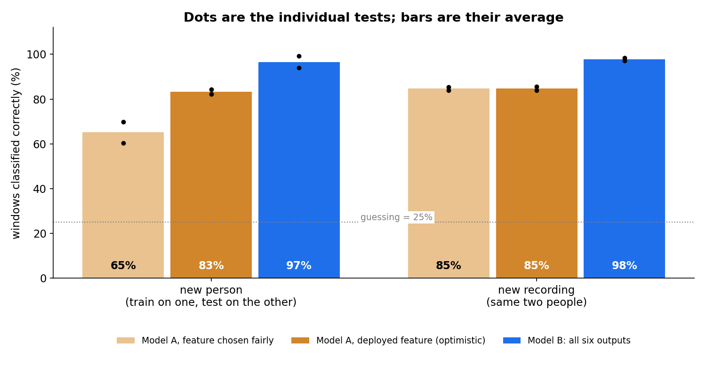
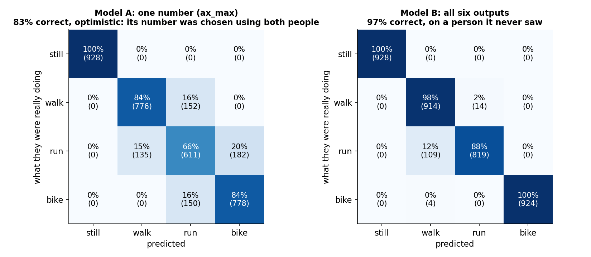
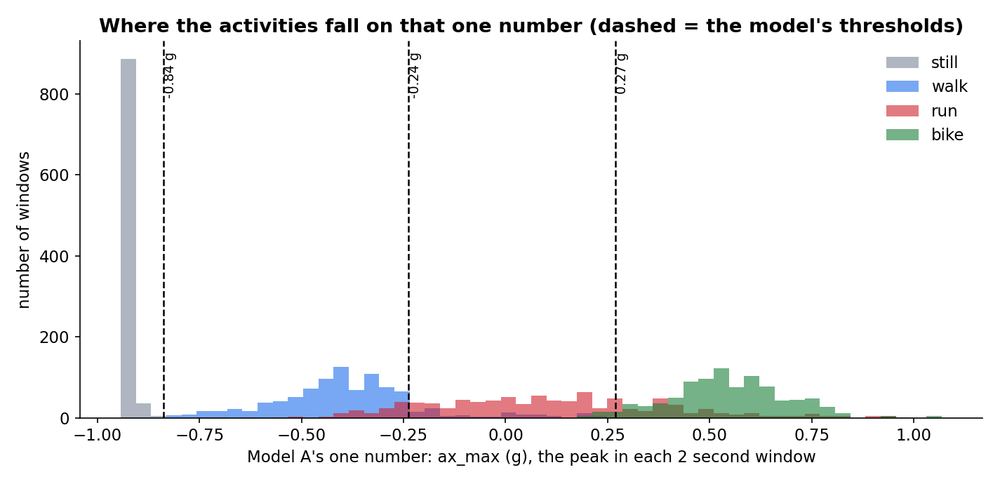
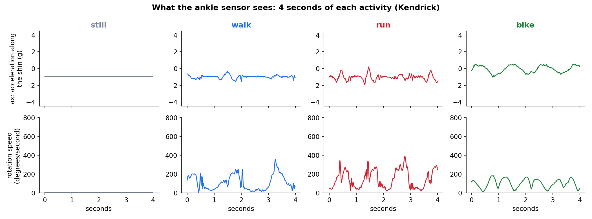

# Gait identifier

A wearable that tells whether you are **standing still, walking, running or biking** (air-biking, lying on your back). It is an Arduino UNO Q with an MPU-6050 motion sensor (3-axis accelerometer + 3-axis gyroscope), strapped to the ankle. No neural networks: both models are decision trees.

There are two models, so we can ask what the extra information is worth:

| | What it is allowed to look at |
|---|---|
| **Model A** | **One number** per window: the peak acceleration in one direction (`ax_max`, the highest reading along the axis that runs down the shin) |
| **Model B** | **All six IMU outputs**: 34 numbers per window (average, spread, lowest and highest value of each output, plus two rhythm measures). The final tree ends up using only a handful of them |


## Results

Data: 2 people (Kendrick, Marie) × 4 activities × 2 recordings × 120 s, recorded on the same unit. Cut into 2 second windows, a new one every 0.5 s.

| Test | Model A, one number (fair) | Model A, one number (optimistic) | **Model B, all six outputs** |
|---|---|---|---|
| **New person** (train on one, test on the other) | 65% | 83% | **97%** |
| **New recording** (same two people) | 85% | 85% | **98%** |



Why two numbers for Model A on a new person: with only two people, its number can be chosen *fairly* (using only the training person's recordings) only from one person, and that choice did not transfer. The model on the board uses `ax_max`, which was chosen using both people, so its 83% is optimistic. The truth for a new person lies between 65% and 83%. Model B has no number to choose, and its settings were not tuned on the test results, so its 97% needs no such caveat. A third person would settle it.



## Which model works better, and why

**Model B, in every test.** Against Model A's optimistic score it wins by about 13 points on a new person (12 to 15 for each person), and against the fair score by about 30.

* **One number cannot separate neighbours.** Along `ax_max` the activities fall in a neat order (still, walk, run, bike), but walking overlaps running, and running overlaps biking. Where the histograms overlap, no threshold can be right. Model A's errors are exactly those neighbours: walk and run get mixed up, and run and bike do too.



* **Model B looks at what one number hides.** Its tree first asks about the Y axis (`ay`) to split *moving on your feet* from *still or biking*, then uses how big the movement is (average and highest acceleration) and a few rotation numbers to tell neighbours apart. It never needed the rhythm numbers it was offered. In the recordings, biking is a smooth, regular roll, running is sharp bursts, and still is flat.



* **Model B's remaining error** is running called walking: 23% of Kendrick's running windows when it is trained on Marie only, and none the other way round. Kendrick runs less hard (1.34 g average acceleration while running, against Marie's 1.53 g), so his running looks like her walking. More people in the training data is the fix.

The two final trees: [Model A](results/tree_model_a.png) (three thresholds) and [Model B](results/tree_model_b.png). All numbers and tables are in [results/summary.md](results/summary.md).

## How the evidence was kept honest

* Every split is by **person** or by **recording**, never by window, because neighbouring windows overlap and look alike.
* Model A's feature is chosen from the **training windows only**. A test proves that shuffling the held-out person's labels, or replacing their data with garbage, changes nothing the models chose or learned.
* Both trees' settings are simple and fixed in the code (depth 4 for B, three thresholds for A). A first exploratory run used similar settings, and none were changed after the final results were seen.
* The board runs the exported trees with plain Python; a test checks they give scikit-learn's answer on all 3,712 windows.

## Limits

* **Two people, 32 minutes.** The windows overlap by 75%, so there are about a quarter as many independent windows as the counts suggest; read differences of a few percent as noise.
* **Biking here looks like air-biking on your back.** The gravity direction in the biking recordings is very different from standing, and Model B uses that posture. A real bicycle, sitting up, would probably fool it.
* **The unit must be mounted the same way.** The X axis runs down the shin; a different mounting changes every axis-based number.
* **The accelerometer is not calibrated.** Gravity reads 0.95 g standing and 1.09 g flat on a bench. This is a constant error, so it does not hurt a model trained on the same unit.
* **Intensity differs between people.** Thresholds learned on one person's running can sit too high for another's.

## Run it

```
pip install numpy scikit-learn matplotlib
python train_gait.py          # evaluates both models, writes results/ and models/gait_models.json
python tests/test_gait.py     # about a minute
```

```python
import numpy as np, gait_features as gf
from gait_predict import GaitModels          # no scikit-learn needed
models = GaitModels()
window = gf.windows(np.loadtxt("data/Marie__run__20261027-034912.csv", delimiter=",", skiprows=1, usecols=range(1, 7)))[40]
print(models.predict(window))                # ('run', 'run')  = (Model A, Model B)
```

## Files

| | |
|---|---|
| `data/` | The 16 recordings and `manifest.csv`, made by the Gait Recorder app (columns `n, ax, ay, az, gx, gy, gz`; 100 samples a second) |
| `gait_features.py` | Windows and features; used by both training and the live app |
| `train_gait.py` | Loads, evaluates, trains, exports, draws |
| `gait_predict.py` | Runs the exported trees on the board |
| `models/gait_models.json` | The two trained trees |
| `results/` | Figures, `summary.md`, `results.json` |
| `tests/test_gait.py` | Windows, features, loader, no-leakage, held-out isolation, exported = scikit-learn, repeatability |

Status: the training and evaluation are done. The live demo app (both models side by side, on the board's web page and LED matrix) is the next step.
